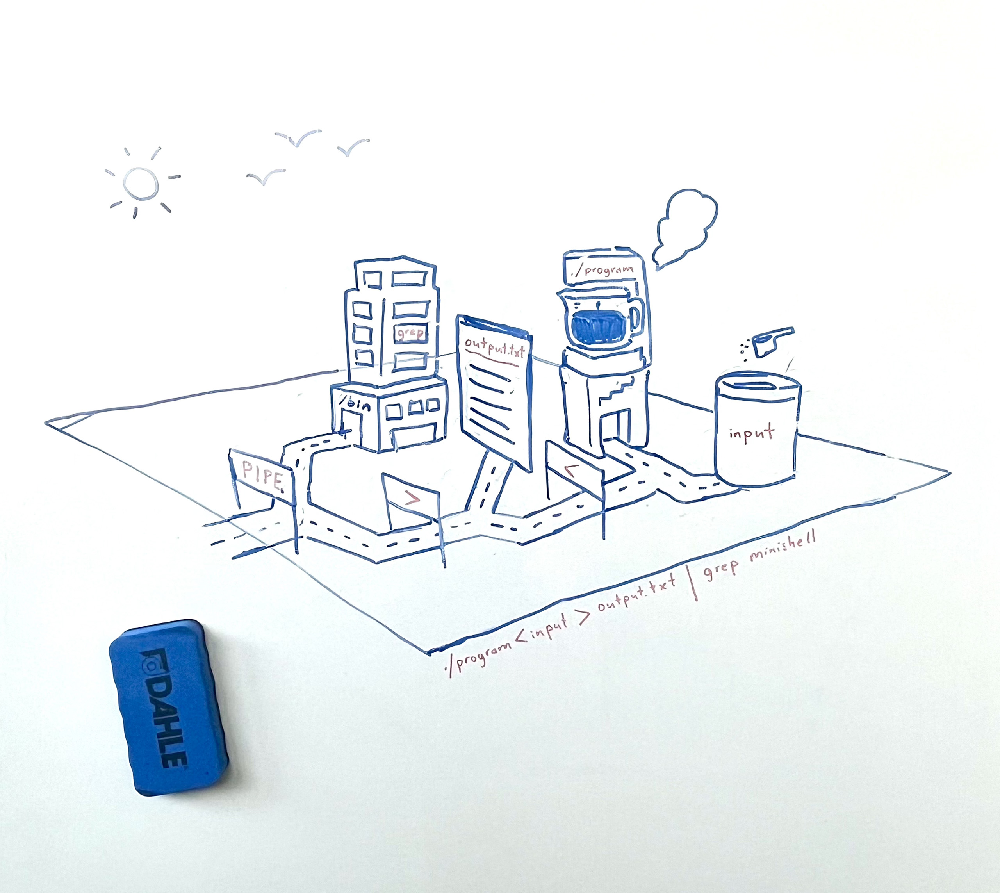

# Minishell

a Bash-like shell in C.

Created by @h-allison & @minorSeventhMusic as part of the Core Curriculum at 42 Berlin.
                                              

**Minishell is a compact Unix shell, written in C, that replicates essential behaviors of bash.**

Created by @minorSeventhMusic and @h-allison as part of the Core Curriculum at 42 Berlin.

## Features

<table>
  <tr>
    <th valign="top", align="left">Commands</th>
    <th valign="top", align= "left">Operators</th>
    <th valign="top", align ="left">Supports</th>
  </tr>
  <tr>
    <td valign="top">
      <ul>
        <li>pwd</li>
        <li>export</li>
        <li>unset</li>
        <li>env</li>
        <li>exit</li>
        <li>echo (option <code>-n</code>)</li>
        <li>cd (relative or absolute path)</li>
      </ul>
    </td>
    <td valign="top">
      <ul>
        <li>| (pipes)</li>
        <li>&gt; (output redirections)</li>
        <li>&lt; (input redirections)</li>
        <li>&lt;&lt; (heredoc)</li>
        <li>&amp;&amp; (AND) </li>
        <li>|| (OR) </li>
      </ul>
    </td>
    <td valign="top">
      <ul>
        <li>single quotes (<code>' '</code>)</li>
        <li>double quotes (<code>" "</code>)</li>
        <li>environment variables (<code>$</code>)</li>
        <li><code>$?</code></li>
        <li>Ctrl-C</li>
        <li>Ctrl-D</li>
        <li>Ctrl-\</li>
      </ul>
    </td>
  </tr>
</table>

Minishell can also handle:
- chained commands with multiple operators
- execution of external commands

Above: whiteboard drawing of command & operator pipeline

## What is a shell?
A shell is a command-line interpreter -- It's the program that runs in your terminal and allows you to interact directly with the the operating system via text input. When you type a command in the terminal, the shell interprets and executes your command.

Since the shell is a program that executes both built-in commands (such as "cd") and external programs (including typical commands like "ls"), it's also the **parent process** of all the processes that it's used to run.

## Bash as the basis for Minishell

Our Minishell is built to mimic the behavior of Bash, one of the most widely distributed shells and often the default on Linux. It was released in 1989, and its name is both an acoronym ("Bourne Again SHell") and a pun about its predecessor, the Bourne Shell. 

Brian Fox, the software engineer who created Bash, tells some very interesting and funny anecdotes about its inception in this [podcast episode](https://open.spotify.com/episode/1g7RRwmaFnFRTALuu8KEyj?si=TmuZKJ6DRBqlZppTa2MFlg").

# Usage:

Build: `make`

Run: `./minishll`

### Syntax Reference:
* `' '` (single quotes) prevents the shell from interpreting the characters contained within</small>
* `" "` (double quote) <small>prevents the shell from interpreting the characters contained within, except for $ (dollar sign).</small>
* `<<` (heredoc)
	- is given a delimiter, then reads the input until a line containing the
delimiter is seen. Doesn't need to update the history!
* `>` (output redirection)
* `<` (input redirection)
* ` | ` (pipe)
	- the ouput of each command in the pipeline is connected to the input of the next command via a pipe.
* `$` environment variables
	- expand to their assigned values
* `$?`
	- expands to the exit status of the most recenetly executed foreground pipeline

In interactive mode:
* `ctrl-C` displays a new prompt on a new line.
* `ctrl-D` exits the shell.
* `ctrl-\` does nothing.

---

# Resources

- [The Linux Programming Interface](https://man7.org/tlpi/)
  an in-depth source of information on linux / UNIX system programming.

- [POSIX Shell Manual](https://pubs.opengroup.org/onlinepubs/9699919799/utilities/V3_chap01.html#tag_17): all about shell commands and their interpretation.

-  [Chaper 4 of Operating Systems: Three Easy Pieces](https://pages.cs.wisc.edu/~remzi/OSTEP/cpu-intro.pdf)

- [GNU Readline Library, Wikipedia](https://en.wikipedia.org/wiki/GNU_Readline)
- [Programming with GNU Readline, MIT](https://web.mit.edu/gnu/doc/html/rlman_2.html)
- [GNUE Readline Library, Case Western Reserve University](https://tiswww.case.edu/php/chet/readline/readline.html)
  ^best summary of all Readline functions, not found in man pages